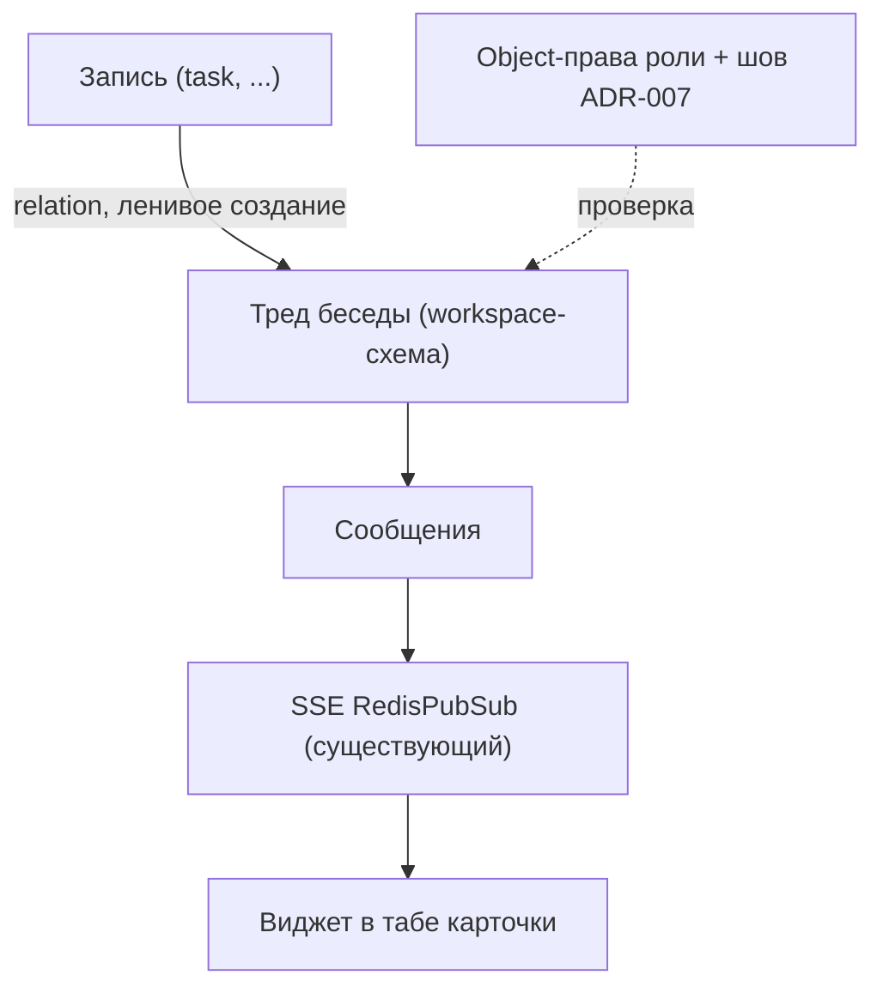

# ADR-002: Беседы и мессенджер (чат, привязанный к записи)

**Статус:** Предложено (утверждение за владельцем)
**Дата:** 2026-10-08
**Основание:** `docs/arch/00-baseline-analysis.md` §4 (сообщения, notes, уведомления), §1d (SSE)
**Связанные:** [ADR-001](ADR-001-module-mechanism.md) (механизм модуля), [ADR-003](ADR-003-business-processes.md) (чат как часть процесса)

> **Поправка 2026-10-12:** модель хранения и прав из этого ADR (сообщения как объекты workspace) и мост Mattermost **отменены** — см. [ADR-010](ADR-010-communications.md). Этот текст — история решения.

---

## Контекст

В чистом Twenty внутреннего чата/комментариев и модуля уведомлений **нет** (baseline §4.2, §4.4: поиск по репозиторию пуст). Что есть как основа:

- **Notes (BlockNote):** текст, файлы, @упоминания (`note.workspace-entity.ts:9-19`, `modules/mention/`), сохранение целым документом (конфликт «последний победил» — предположение baseline).
- **Real-time:** SSE-подписки на записи через RedisPubSub (`event-stream.resolver.ts:75-89`, `object-record-event-publisher`) — фундамент для доставки сообщений без новых сервисов.
- **`WidgetType.CHAT` в табе карточки — это AI-чат записи** (`ChatWidget.tsx:34`), не людской; в side-panel селекторе он даже не выбирается (`SidePanelPageLayoutRecordPageWidgetTypeSelect.tsx:355-401`). Людского чата нет.
- **Права доступа** — object-level (`is-object-operation-permitted.util.ts:20-23`) и field-level (`permissions.utils.ts:116-135`) у ролей; row-level (Enterprise) в форке не используем. Согласованность «кто видит чат ↔ кто видит запись» не даётся «наследованием» автоматически — её обеспечивает серверная проверка в шве (см. [ADR-007](ADR-007-unified-stitch.md)).
- Почтовый мессенджер (`modules/messaging/`) и `SEND_CHAT_MESSAGE` (workflow → Inbox) к людскому чату по записям отношения не имеют.

Требование конкурента Битрикс24: обсуждение прямо в карточке задачи/дела, с правами «как у записи», поиском, вложениями и уведомлениями.

**Факты по Mattermost (официальные источники, WebSearch, октябрь 2026):**

- Исходный код сервера — **AGPLv3** (или коммерческая лицензия), `mattermost/mattermost` LICENSE.txt.
- **Team Edition** — MIT-дистрибутив, self-hosted, «small teams, hobbyists», рекомендация до ~250 активированных пользователей (не hard cap); **SSO из Team убрали в 2025**; нет AD/LDAP/SAML/compliance/advanced access controls (docs.mattermost.com/product-overview/editions-and-offerings).
- **Entry** (бесплатная, коммерческая лицензия) — hard-лимиты: 10 000 сообщений истории, 10 000 push/мес, 1 000 карточек boards, 5 playbook-запусков/мес, звонки 40 мин (mattermost.com/blog/introducing-mattermost-entry).
- **Enterprise/Enterprise Advanced** — платная подписка; по её истечении SSO/LDAP/SAML/compliance отключаются (docs.mattermost.com/about/subscription).
- Product limits: 10 вложений/сообщение, файл ≤100 МБ, сообщение ≤16 383 символов, «users per team» — без enforced limit.

## Варианты

### A. Нативные беседы на Postgres + Redis/SSE (без внешних сервисов)

Новые workspace-сущности «тред» (привязка к записи) + «сообщение треда»; доставка — существующий SSE; вкладка «Чат» — данные-driven `pageLayoutTab` с front-component виджетом или штатным виджетом (см. ограничение ниже).

### B. Mattermost отдельным сервисом

Канал на запись/задачу, SSO, маппинг workspace → team; интеграция через API/вебхуки.

### C. Гибрид

Фаза 1 — нативные беседы в записях; фаза 2 — опциональный Mattermost-мост (внешняя команда/мобильные клиенты) как плагин, не как основа.

## Критерии

| Пункт | A: нативно | B: Mattermost | C: гибрид |
|---|---|---|---|
| **Операционная нагрузка** | 0 новых контейнеров: уже есть Postgres 16 + Redis 7 (`docker-compose.dev.yml`); новые таблицы в workspace-схеме | +2 контейнера (приложение + отдельная БД), свой цикл обновлений/бэкапов/мониторинга, ещё один продукт в аптайме; на 16 ГБ dev-машине заметно (baseline §0.3) | как A сейчас; B — опцией позже |
| **Изоляция тенантов** | Готовая: workspace-схема + `workspaceId`, контекст в запросах (§5 baseline) | Нужен маппинг workspace → team, провижининг при создании/удалении workspace, риск утечки между командами, отдельная модель «system admin» | A как основа |
| **Лицензия Mattermost** | не применяется | Источники AGPLv3; Team (MIT) — **без SSO**, «не для чувствительных рабочих нагрузок», ~250 юзеров рекомендацией; Enterprise (SSO/LDAP/SAML/compliance) — платная подписка, по истечении фичи гаснут; Entry — free, но hard-лимиты (10к сообщений истории) | A без лицензионных рисков; мост — осознанный выбор позже |
| **Права доступа (кто видит чат — как у записи)** | Права на сообщения — объектные права роли; согласованность с правами на запись — серверная проверка в шве (ADR-007); RLS (Enterprise) не используем | Своя permissions-модель каналов; нужен маппинг ролей Twenty → Mattermost, неизбежный дрейф; права канала ≠ права записи | A |
| **Поиск** | Нужно строить (Postgres FTS/pg_trgm по сообщениям) — скрытая часть объёма | Встроенный, зрелый — готов | A + доработка |
| **Уведомления** | Модуля уведомлений в Twenty **нет** (§4.4) — главная скрытая стоимость: свой inbox + email-дренаж | Готовые, включая mobile push (с лимитами Entry) | A: минимальный inbox с самого начала; push — аргумент моста |
| **Вложения** | Переиспользовать файловое хранилище записей (attachments) | Отдельное хранилище Mattermost — дублирование | A |
| **10 000 задач → число каналов** | 10 000 тредов = обычные строки workspace-схемы (лениво, при первом сообщении); проверить EXPLAIN на 10k | **10 000 каналов**: провижининг API, лимит «Teams per deployment 10 000», деградация sidebar/поиска/push-подписок, нагрузка на отдельный сервис | A |
| **Миграция истории** | История новая — мигрировать нечего | При переходе на B — импорт истории в каналы (дорого); риск «провалиться» в чужой продукт | История едина с начала, мост — надстройка |

## Решение (рекомендация)

**Вариант C — гибрид: фаза 1 нативные беседы, фаза 2 опциональный Mattermost-мост.**

Предварительный вес владельца **подтверждается с двумя поправками**:

1. «Нативные беседы = согласованные с записью права и нулевой лишний сервис» — **верно с уточнением**: права на сообщения задаются объектными правами роли; согласованность с правами на запись обеспечивается серверной проверкой в шве (ADR-007), а не «наследованием»; новых контейнеров нет.
2. «Mattermost оправдан внешней командой на готовых мобильных клиентах» — **верно, но с уточнениями**: (а) для корпоративного SSO нужен **платный** Enterprise — Team с 2025 года SSO не даёт, а наш продукт SSO сам по себе Enterprise-гейт (ADR-006); (б) тред-на-канал для 10 000 задач упирается в провижининг и лимиты каналов; (в) нативные беседы **реально стоят L** — это не «немного кода», а треды/unread/уведомления/поиск (baseline §4.3: «чат/DM требует до-стройки тредов/комнат/unread/уведомлений»). Опровержение весу — не в пользу Mattermost, а в том, что «0 лишних сервисов» не значит «дёшево»: экономия на сервисах тратится на построение уведомлений.

Критерий перехода к фазе 2: появился сегмент внешних пользователей/нужен мобильный клиент раньше, чем нативный inbox готов.

## Последствия

- **Плюсы:** права на сообщения — через object-права роли + шов ADR-007; 0 новых контейнеров и лицензионных ограничений; данные чата живут рядом с записью и попадают в бэкап/поиск/миграции вместе с ней.
- **Минусы:** весь «мессенджерный» функционал строится своими силами — треды, unread, уведомления (модуля нет), поиск, умеренная реакция на 10k тредов; нет мобильных клиентов на фазе 1; риск свернуться в «починку AI-чат виджета» вместо людского чата.
- **Процессно:** модуль — по ADR-001 (App + швы по PATCHES.md); сущность чата — standard-объект либо app-объект, выбор фиксируется при прототипе.

## Что нужно проверить прототипом

1. **Тред на запись:** сущность `conversationThread` (relation на запись) + сообщения; ленивое создание; виджет в карточке через данные-driven таб (без правок ядра — `WidgetType.FRONT_COMPONENT` либо штатный шаблон). Сколько файлов ядра тронуто (ожидание: 0–1).
2. **Производительность:** вставка/чтение треда на 10 000 задач в dev-seed workspace (EXPLAIN, latency SSE-подписки).
3. **Права:** роль без права чтения объекта `task` не читает и треды/сообщения этого task (доступ через GraphQL и SSE) — объектные права роли + серверная проверка в шве (ADR-007).
4. **Уведомления:** минимальный inbox (тостов уже нет — нужен источник событий) — оценить объём против готового решения Mattermost.
5. **Mattermost spike (если вес владельца сохранится):** docker compose, создание канала на запись через API, маппинг workspace→team, показать отсутствие SSO в Team и cost Enterprise; экспорт/импорт истории.

## Поправки 2026-10-09

Верификация на базе `twenty/v2.45.6` (см. `docs/arch/02-verification-at-base.md`):

- Убрана формулировка «права наследуются от записи». Замена: права на сообщения задаются объектными правами роли; row-level (Enterprise) не используем; согласованность с правами на запись обеспечивается серверной проверкой в шве ([ADR-007](ADR-007-unified-stitch.md)).
- Прототип №3 переформулирован: роль без права чтения объекта `task` не читает и треды/сообщения этого task (доступ через GraphQL и SSE).
- Рекомендация варианта C не менялась.
