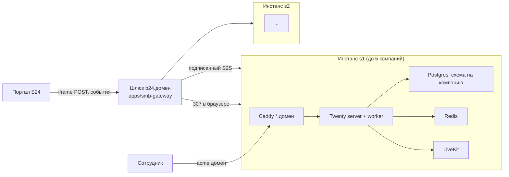

# ADR-008: Топология инстансов и шлюз канала Битрикс24

**Статус:** Утверждено владельцем 2026-10-12 (TODO O-1)
**Дата:** 2026-10-12
**Основание:** вход владельца 2026-10-12 (серверы по ~5 компаний, одна ссылка приложения Б24 на всех, авто-регистрация); отчёт S6-bitrix-design (история git); чтение кода на базе `twenty/v2.45.6`
**Связанные:** [ADR-006](ADR-006-module-activation-license.md) (лимиты), [ADR-009](ADR-009-module-contract.md) (embed-поверхности модулей)
**Уточняет:** план v3 (история git) §1 и §6 (там модель «один инстанс»)

---

## Контекст

Вход владельца меняет модель развёртывания: не «один сервер на всех», а **много серверов, на каждом ~5 компаний**, у каждой компании свой сабдомен. При этом приложение в маркетплейсе Битрикс24 имеет **один** адрес обработчика на всех клиентов — нужен маршрутизатор «портал → сервер → компания», вход без регистрации и кнопка «в полную CRM».

Факты на базе (прочитано, не запускалось):

- Мультиарендность штатная: `IS_MULTIWORKSPACE_ENABLED` (`config-variables.ts:2110`), workspace определяется по сабдомену (`workspace-domains.service.ts:140-162`), данные — схема Postgres на workspace.
- Лимит без Enterprise-ключа — **5 workspace на инстанс**: `MAX_WORKSPACES_WITHOUT_ENTERPRISE_KEY = 5` (`auth/constants/max-workspaces-without-organization-key.constants.ts:1`), проверка `assertWorkspaceCountWithinLimit` (`sign-in-up.service.ts:569-587`).
- Разрешение встраивания во фрейм **уже есть per-workspace**: поле `allowedIframeOrigins` (`workspace.entity.ts:324`) → `frame-ancestors 'self' <origins>` и снятие `X-Frame-Options` (`frontend.service.ts:138-147`). Патч ядра для динамического `frame-ancestors` не нужен.
- Штатные маршруты входа: `/verify?loginToken=…` (`AppPath.ts:2`, `VerifyLoginTokenEffect.tsx:12-29`), `/reset-password/:passwordResetToken` (`AppPath.ts:6`); сервисы `login-token.service.ts`, `reset-password.service.ts`.
- Старый контур `company-tunnel` (v2.42.6) рассчитан на один инстанс: строка туннеля, привязка `(companyTunnelId, bitrixUserId)`, DNS через Reg.ru, тихий вход через `loginToken`.

Адрес обработчика приложения фиксируется при публикации в маркетплейсе. Если опубликовать адрес одного сервера, второй сервер потом не добавить без перевыпуска приложения. Поэтому маршрутизацию надо заложить **до** публикации, даже пока сервер один.

## Варианты

### A. Один большой инстанс на всех

Как в плане v3. Упирается в лимит 5 workspace (правка константы запрещена до юриста), общий отказ на всех клиентов, один размер сервера.

### B. Много инстансов без общего входа

Каждому серверу своё приложение Б24. В маркетплейсе одно приложение — не подходит.

### C. Много инстансов + тонкий шлюз (рекомендация)

Отдельный маленький сервис на постоянном адресе (например `b24.<домен>`), который знает только «какой портал на каком сервере», и не лежит на пути данных CRM.

## Решение (рекомендация): вариант C

### 1. Инстанс

Один сервер = один стек Twenty (server, worker, Postgres, Redis, LiveKit из [ADR-010](ADR-010-communications.md)), **не больше 5 компаний**. Константа лимита не трогается: шестая компания уходит на следующий сервер. Это снимает вопрос №2 плана v3 без юриста; сам ADR-006b остаётся замороженным.

### 2. Шлюз `apps/smb-gateway`

Отдельное приложение в нашем каталоге `apps/` (ядро не трогает), своя маленькая БД:

- `instance(id, publicHost, internalUrl, capacity, isAcceptingTenants)`
- `portal_route(memberId UNIQUE, portalDomain, instanceId, workspaceSlug, status, createdAt)`
- `route_log` — append-only журнал с причиной.

Что делает:

| Запрос от Б24 | Действие шлюза |
|---|---|
| Открытие приложения в портале (POST во фрейм) | найти `portal_route` по `member_id` → ответ **307** на `https://<slug>.<домен>/api/bitrix/placement` (метод и тело сохраняются). Запасной вариант — HTML с авто-отправкой формы |
| `ONAPPINSTALL` | проверить портал (`assertPortalClaim`, только домены из белого списка Б24), выбрать инстанс со свободным местом, вызвать его `provision` подписанным запросом, записать маршрут. Повтор по тому же `member_id` возвращает тот же маршрут |
| `ONAPPUNINSTALL` | найти маршрут, переслать на инстанс; `application_token` сверяет инстанс (эталон хранится там, `enc:v2`) |
| Нет свободного инстанса | страница «заявка принята» + уведомление владельцу; серверы автоматически не создаются |

Шлюз **не хранит** токены Б24 и данные CRM. Вызовы шлюз → инстанс: HMAC + timestamp + nonce, отдельный секрет на инстанс, эндпоинты инстанса `/api/smb-internal/*` закрыты от внешней сети.

Клиенты без Битрикс24 заводятся командой шлюза (`gateway tenant:create --slug … --instance …`) — тот же `provision`, без портала.

### 3. Сабдомены и сертификаты

Адрес компании — `<slug>.<домен>` независимо от сервера. При `provision` шлюз создаёт DNS-запись `<slug> CNAME <publicHost инстанса>` через API провайдера. Перенос компании на другой сервер = смена CNAME. На каждом инстансе Caddy с wildcard-сертификатом `*.<домен>` (DNS-01). `DNS_ROOT_DOMAIN` — обязательная переменная без значения по умолчанию (закрывает M7).

Альтернатива без DNS API: зона на инстанс (`<slug>.s1.<домен>`). Проще, но адрес привязан к серверу и переезд меняет ссылку клиента.

### 4. Вход во фрейме без регистрации

1. Б24 при каждом открытии присылает свежий `AUTH_ID` и `member_id`.
2. Инстанс (`POST /api/bitrix/placement`) проверяет их обратным REST-вызовом к порталу (`user.current`), домен берёт из своей БД, не из тела запроса.
3. Личность = `(member_id, b24_user_id)`. Привязка есть → сессия. Привязки нет → создать пользователя и участника компании, записать привязку.
4. В ответ отдаётся страница embed-оболочки с одноразовым кодом **в теле** (не в URL); фронт меняет его на токены и держит их **в памяти вкладки**, без cookie и localStorage. Перезагрузка фрейма повторяет шаги 1–4, поэтому хранилище не нужно и блокировка сторонних cookie (Safari, Firefox, WebView) не мешает.
5. `allowedIframeOrigins` компании = подтверждённый origin портала, выставляется при `provision`.

Правила авто-регистрации:

- Email из `user.current` не доказывает владение ящиком (его задаёт администратор портала). Если на инстансе **уже есть** пользователь с таким email без привязки к этому порталу — не сливать молча: показать «подтвердите почту», слияние только после перехода по ссылке из письма.
- Новый пользователь создаётся без пароля (поле пустое, не случайная строка) и только в компанию своего портала.
- Роль нового участника — минимальная роль модуля (см. ADR-009), администратор портала получает роль администратора компании только при установке.

### 5. Кнопка «Перейти в полную CRM»

1. Фронт embed-оболочки вызывает `POST /api/bitrix/handoff` со своей сессией.
2. Сервер сам строит адрес: слаг из БД, хост сверяется с `<slug>.<DNS_ROOT_DOMAIN>` через `new URL()` (закрывает H1 — слаг из query больше не участвует).
3. Пароля нет → одноразовый `passwordResetToken` → `https://<slug>.<домен>/reset-password/<token>`: почта подставлена, пользователь придумывает пароль и попадает в CRM.
4. Пароль есть → одноразовый `loginToken` → `https://<slug>.<домен>/verify?loginToken=…`.
5. Ссылка открывается в новой вкладке (верхний уровень, обычные cookie). Срок жизни токена — минуты, одно использование.

### 6. Что видно во фрейме

Во фрейме открывается не вся CRM, а **embed-поверхность модуля** (первым — документооборот): маршрут `/embed/<module>` без боковой панели, с кнопкой из п.5. Какие модули имеют embed-поверхность, описывает манифест модуля (ADR-009).

## Последствия

- **Плюсы:** лимит 5 соблюдается без правки ядра; отказ сервера задевает до 5 клиентов; адрес приложения в маркетплейсе не меняется при росте; шлюз мал и не видит данных; 0 новых патчей ядра для `frame-ancestors` и входа.
- **Минусы:** появляется второй деплоймент (шлюз) и его БД — их надо бэкапить и мониторить; шлюз становится точкой отказа для **открытия из Б24** (прямой вход по сабдомену от него не зависит); N серверов = N обновлений и N бэкапов; DNS API провайдера входит в критический путь установки.
- **Процессно:** код `company-tunnel` старого билда делится на две части — «маршрут и установка» уходит в шлюз, «привязка пользователя и сессия» остаётся на инстансе (серверный модуль по ADR-009). Перенос — только после ревизии по S6.

## Что нужно проверить (все пункты NOT RUN)

1. **E8:** 307 на другой origin внутри фрейма Б24 сохраняет POST-тело в Chrome, Safari, Firefox и мобильном приложении Б24. Провал → авто-отправка формы.
2. **E1 (из S6), уточнённый:** сессия только в памяти — фронт Twenty работает без cookie `tokenPair`; сколько файлов ядра задевает такой режим (ожидание: один шов в состоянии авторизации).
3. **E9:** `ONAPPINSTALL`/`ONAPPUNINSTALL` приходят на адрес шлюза и доходят до инстанса; повтор install не создаёт второй workspace.
4. **E10:** страница `/reset-password/:token` показывает почту и после смены пароля входит в нужный workspace на сабдомене.
5. **S5 (из плана):** лимит 25 мест на инстанс — что именно он блокирует при 5 × 50 = 250 пользователях. **Проверено 2026-10-12** (отчёт S-S5 (история git)): блокируется только кастомный AI-провайдер (добавление в админ-панели — единственное место броска исключения + текст ошибки модели); счётчик мест — `COUNT(DISTINCT userId)` **по всему инстансу**, без разреза по компаниям; число компаний лимитирует другая константа (`MAX_WORKSPACES_WITHOUT_ENTERPRISE_KEY = 5`).
6. Нагрузочный замер 5 × 50 пользователей — по нему размер сервера.
7. Юрист (не блокирует архитектуру): 152-ФЗ и место хостинга, AGPL §13 для шлюза и модулей.
